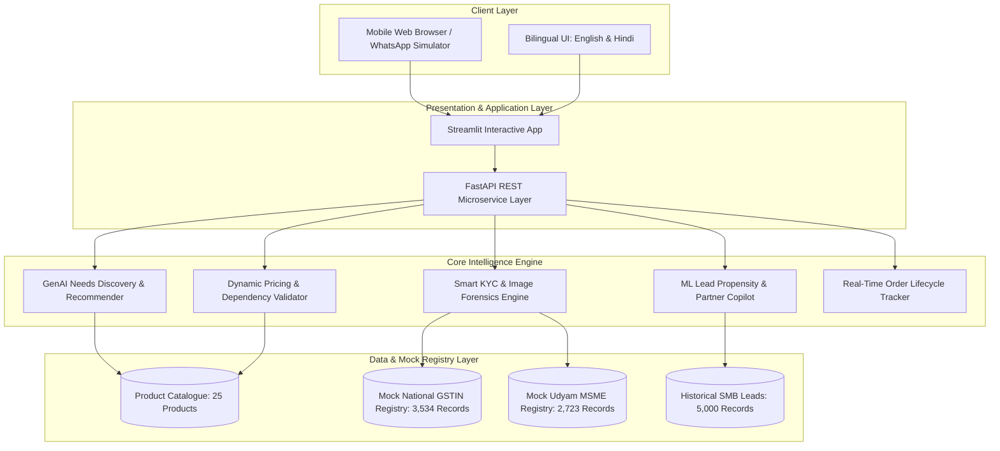

# ⚡ Project Udyam Digital: Airtel Business MSME Digital-First Onboarding

[](https://www.python.org/)
[](https://fastapi.tiangolo.com)
[](https://streamlit.io)
[](LICENSE)
[]()

> **Making India's 6 Crore+ Micro, Small, and Medium Enterprises (MSMEs) Go Digital in One Sitting.**  
> *Developed for the Accel Telecom / Airtel Enterprise Hackathon (Track A: Project Udyam Digital).*

---

## 📌 Executive Summary

Accel Telecom / Airtel dominates consumer telecom, but **only 7.4% of SMB leads currently convert to active enterprise accounts**. The legacy journey is plagued by slow field sales visits, fragmented billing, paper-heavy documentation taking **17.6 days**, and customers making **3+ chasing calls** just to get broadband and business SIMs installed.

**Project Udyam Digital** transforms this fragmented funnel into a **frictionless, 10-minute digital experience** available in **English and Hindi** on any smartphone:
1. **🤖 GenAI Conversational Advisor:** Discovers business needs in minutes and prescribes eligible, bundle-optimized connectivity and SaaS packages.
2. **🛒 Modular Transparent Quote & Checkout:** Eliminates cryptic PDFs with single-bill itemization, tenure discounts, and setup fee waivers.
3. **🛡️ Smart KYC & DPDP 2023 Compliance Gate:** Instant ISO 7064 GSTIN checksum verification, Udyam MSME cross-checks, document image forensics (blur and skew detection), and cryptographic PII masking.
4. **📍 Live Order Tracker & SLA Assurance:** Milestone visibility with assigned engineer details and self-service slot booking, reducing chasing calls to zero.
5. **📊 Sales Copilot & ML Lead Propensity Engine:** Prioritizes unclosed leads for field reps and channel partners using machine learning with tailored Next Best Actions (NBA).

---

## 🏛️ High-Level System Architecture



---

## 🎯 Target Segments & Product Bundling

| MSME Segment | Share | Typical Example | Key Needs | Prescribed Bundle | Indicative Price |
| :--- | :---: | :--- | :--- | :--- | :---: |
| **Micro Retail & Services** | 55% | Kirana, Salon, Pharmacy | 100% UPI/POS uptime, WhatsApp store, calling | Biz Fibre 100 / 5G AirFiber + 1 Postpaid SIM + Cloud POS | ₹1,298 / mo |
| **Professional Offices** | 25% | Clinic, CA Firm, Coaching Centre | Cloud storage, domain email, high uptime, security | Biz Fibre 300 + 3 Postpaid SIMs + Cloud Email + Failover | ₹2,745 / mo |
| **Small Multi-Site Businesses** | 15% | Restaurant Chain, 3-10 Store Retailer | Central billing, site-to-site connectivity, CCTV | Biz Fibre 300 (per site) + SD-WAN + Cloud CCTV + Postpaid 599 | ₹7,490 / mo |
| **Small Manufacturers** | 5% | Auto-parts unit, Textile mill | Dedicated symmetric bandwidth, ERP access, IoT | Internet Leased Line 20 Mbps (99.9% SLA) + Endpoint Security | ₹11,200 / mo |

---

## 🛡️ Smart KYC & Image Forensics Engine

The Smart KYC engine executes automated checks against statutory regulations:
- **ISO 7064 Mod 36, 36 Checksum Validation:** Algorithmic verification of the 15th character of the GSTIN without calling remote servers.
- **Embedded PAN Structure Verification:** Validates alphanumeric format and accepts synthetic identifier flags (`X` in position 4).
- **Mock Registry Cross-Matching:** Compares submitted trade name, legal constitution, and address against `mock_gstin_registry.csv` and `mock_udyam_registry.csv`.
- **Image Blur & Quality Detection:** Computes variance of Laplacian on uploaded document images (scores `< 100` flagged as illegible blur).
- **Document Skew & Geometry Detection:** Detects misaligned document borders and excessive tilt.
- **Address Proof Recency Check:** Enforces 90-day regulatory validity from anchor date `2026-07-15`.
- **DPDP Act 2023 Masking:** Automatically masks sensitive PII (PAN, GSTIN, Aadhaar, Phone) across UI displays and logs.

---

## 📂 Repository Structure

```text
udyam-digital-repo/
├── app.py                      # Main Interactive Streamlit Application (5 Tabs)
├── requirements.txt            # Python Dependencies
├── environment.yml             # Conda Environment Specification
├── LICENSE                     # MIT Open-Source License
├── README.md                   # Project Documentation
├── core/                       # Core Intelligence & Business Logic
│   ├── __init__.py
│   ├── advisor.py              # Bilingual AI Advisor & Bundle Recommendation
│   ├── pricing.py              # Pricing, Add-Ons & Product Dependency Engine
│   ├── kyc_engine.py           # Smart KYC, Checksum, Registry & Forensics
│   ├── ml_scoring.py           # ML Lead Propensity Model & Funnel Analytics
│   ├── tracker.py              # Order Timeline & SLA Countdown Engine
│   └── api.py                  # FastAPI REST Microservice Endpoints
└── data/                       # Synthetic Test Datasets
    ├── product_catalogue.csv   # 25 Accel Business Products & Eligibility Rules
    ├── mock_gstin_registry.csv # 3,534 National Taxpayer Records
    ├── mock_udyam_registry.csv # 2,723 MSME Registry Records
    ├── smb_leads.csv           # 5,000 Historical Leads & Outcomes
    └── kyc_documents/          # 47 Specimen Document Images (Applicants K01-K12)
```

---

## 🚀 Quickstart Guide

### 1. Environment Setup (Terminal or VS Code)
```bash
# Clone the repository
git clone https://github.com/YOUR_USERNAME/udyam-digital.git
cd udyam-digital

# Create virtual environment (Python 3.10+)
python -m venv venv

# Activate virtual environment
# On Windows (cmd/powershell):
venv\Scripts\activate
# On Linux/macOS:
source venv/bin/activate

# Install dependencies
pip install -r requirements.txt
```

### 2. Launch the Streamlit Portal
```bash
streamlit run app.py
```
Open your browser at `http://localhost:8501`.

### 3. Launch the Headless FastAPI Service (Optional)
```bash
uvicorn core.api:app --reload --port 8000
```
Interactive API documentation will be available at `http://localhost:8000/docs`.

---

## 📈 Key Impact & Funnel Economics

| Funnel Metric | Baseline (Manual Journey) | Udyam Digital (Target) | Enterprise Impact |
| :--- | :---: | :---: | :--- |
| **Lead-to-Activation Rate** | 7.4% (368 / 5,000) | **25.0%** (1,250 / 5,000) | **+3.4x More Paying MSMEs** |
| **Lead to Activation Cycle** | 17.6 Days | **< 48 Hours** | **88% Faster Time-to-Revenue** |
| **Customer Status Chases** | 3.1 Calls / Order | **0 Calls (Self-Service)** | **Eliminates Support Backlog** |
| **Blended Acquisition Cost (CAC)** | ₹15,000 / Activated | **₹4,200 / Activated** | **72% Reduction in S&M Cost** |
| **Quote Accept Rate** | 43.6% (861 / 1,974) | **75.0%** | Single transparent bill eliminates drops |

---

## 👥 Contributors & Acknowledgements
- **Team:** Airtel SYNC Hackathon 2026 Innovation Team
- **Case Reference:** Accel Telecom Enterprise Track A (Project Udyam Digital)
- **Frameworks:** Streamlit, FastAPI, Scikit-Learn, Pandas, Pillow

